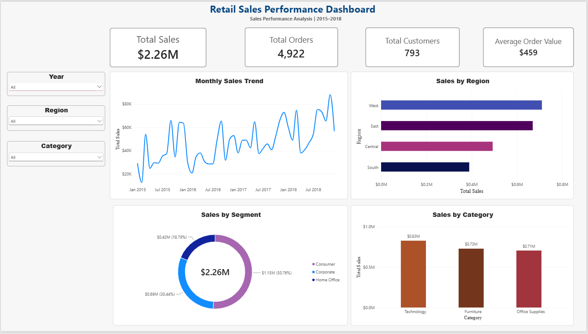
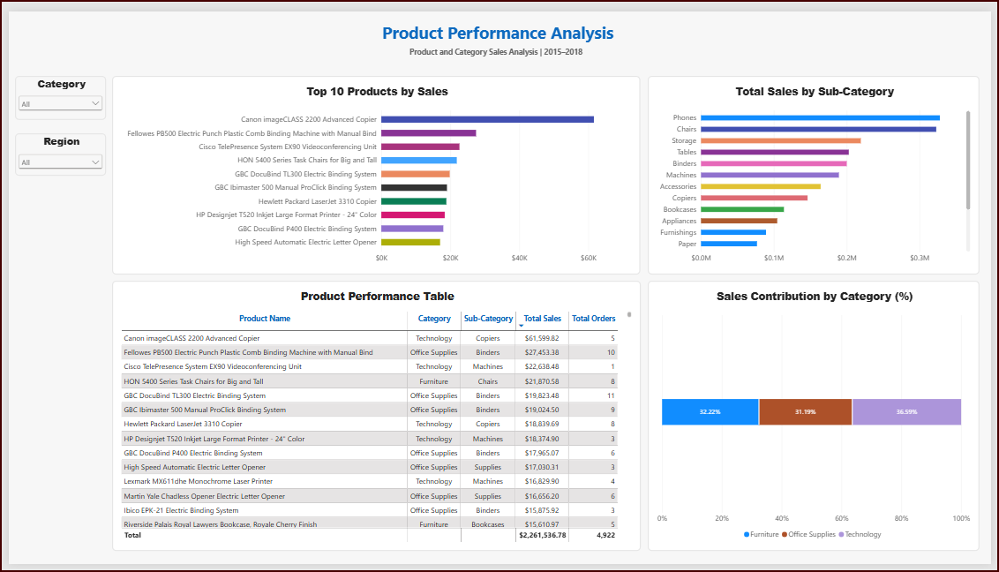
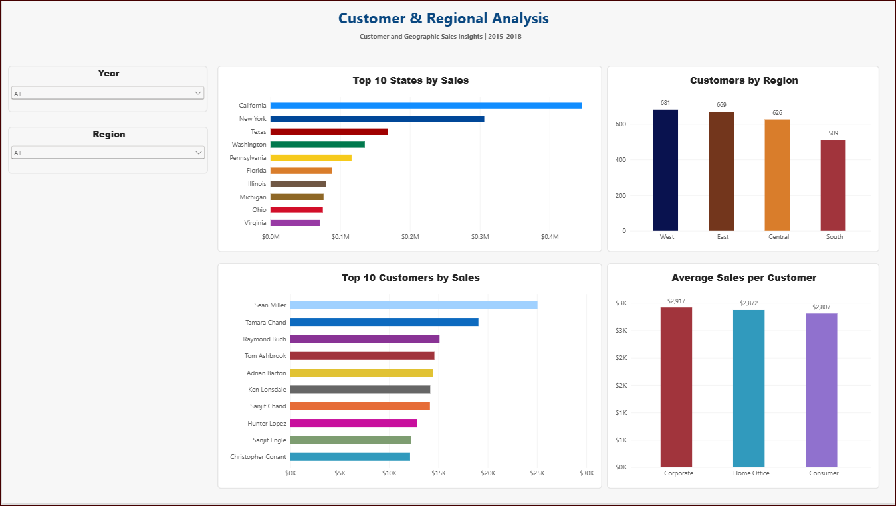

# Retail Sales Performance Analysis | Power BI

## Project Overview

This project analyzes retail sales data from 2015 to 2018 using Microsoft Power BI. The goal is to explore sales trends, identify top-performing products, understand customer purchasing patterns, and compare sales performance across different regions.

I created a three-page interactive dashboard to present the findings in a clear and easy-to-understand way.

## Tools & Skills Used

- **Power BI Desktop** – Dashboard development and interactive visualizations
- **DAX** – Calculated measures and key performance indicators (KPIs)
- **Data Analysis** – Exploring sales, product, customer, and regional performance
- **Data Visualization** – Bar charts, line charts, donut charts, tables, and slicers
- **Business Intelligence** – Turning sales data into meaningful business insights

## Dashboard Pages

### 1. Executive Overview



Provides an overview of retail sales performance, including:

- Total Sales: $2.26M
- Total Orders: 4,922
- Total Customers: 793
- Average Order Value: $459
- Monthly sales trends
- Sales performance by region, customer segment, and product category

### 2. Product Performance Analysis



Analyzes product-level sales performance through:

- Top 10 products by sales revenue
- Sales by product sub-category
- Product performance table
- Sales contribution by category

Technology contributed the largest share of revenue at 36.59%, followed by Furniture (32.22%) and Office Supplies (31.19%).

### 3. Customer & Regional Analysis



Explores customer and geographic sales performance, including:

- Top 10 states by sales
- Number of unique customers by region
- Top 10 customers by sales revenue
- Average sales per customer by segment

The West region had the highest number of unique customers (681), followed by East (669), Central (626), and South (509).

## DAX Measures

The dashboard uses the following measures:

**Total Sales**
```dax
Total Sales = SUM(train[Sales])
```

**Total Orders**
```dax
Total Orders = DISTINCTCOUNT(train[Order ID])
```

**Total Customers**
```dax
Total Customers = DISTINCTCOUNT(train[Customer ID])
```

**Average Order Value**
```dax
Average Order Value = DIVIDE([Total Sales], [Total Orders])
```

**Average Sales per Customer**
```dax
Average Sales per Customer = DIVIDE([Total Sales], [Total Customers])
```

## Dataset

**Source:** [Sales Forecasting Dataset – Kaggle](https://www.kaggle.com/datasets/rohitsahoo/sales-forecasting)

The dataset contains retail transactions, including order dates, customer information, product categories, geographic locations, and sales amounts.

## Project Files

- [Power BI Dashboard (.pbix)](Retail_Sales_Analytics_Dashboard.pbix)
- [Dashboard PDF](Retail_Sales_Analytics_Dashboard.pdf)

## Future Improvements

- Add a detailed Business Insights & Key Findings document
- Explore customer purchasing patterns in more detail
- Develop additional DAX measures for deeper analysis

## About This Project

I developed this project to strengthen my Power BI, DAX, data visualization, and business analysis skills. It is part of my data analytics portfolio as I continue building practical experience and preparing for internship opportunities.
